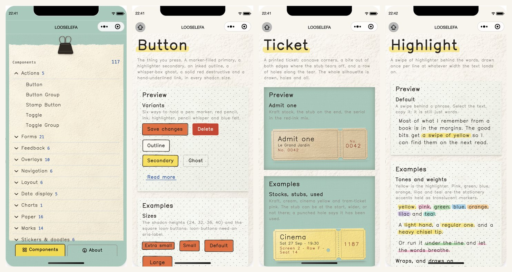

# Looseleaf Miniprogram

English | [简体中文](./README.md)

**Looseleaf, drawn by hand — give your WeChat Mini Program a hand-drawn, paper-textured UI.**

Every component is drawn by a "pen" at runtime: slightly tilted borders, wobbly underlines, stickers and tape — like sketching your UI on loose-leaf paper. This is a WeChat Mini Program port of [looseleaf](https://github.com/kevintngo/looseleaf), with all components under the `ll-` prefix, implemented as native mini program components, tree-shakable by design and ready to use.

<p align="center">
  
</p>

## Components

Of the **104 components** in the upstream [looseleaf](https://github.com/kevintngo/looseleaf) docs site, **100 have been ported**; 4 are skipped due to mini program platform limits — per-component status lives in [docs/components.en.md](./docs/components.en.md).

A few highlights:

**Hand-drawn paper** paper · index-card · polaroid · sticky-note · napkin · ticket · receipt · envelope · notebook · tape · sticker-board

**Marker annotations** highlight · underline · circled · bracket · scribble · stamp · seal · ribbon · lettering

**Interaction** confetti · flip-card · hover-card · signature · dropzone · command · combobox · sidebar

Base & form components (button / card / input / select / table / tabs…), navigation (breadcrumb / pagination / menu…) and overlays (dialog / sheet / toast / dropdown-menu…) are fully covered too. The full per-component comparison table is in [docs/components.en.md](./docs/components.en.md); clone the repo and open `packages/example` in WeChat DevTools to browse every demo, mirroring the upstream docs site.

## Features

- **Runtime ink** — strokes are drawn per element at its real size with a 1:1 stroke width; every instance is a unique "handwriting", with seed control and the full rest / hover / pressed / focus / disabled state layers
- **A complete design system** — upstream tokens (paper, ink, palette, density) are precomputed into WXSS at build time; paper grain, tape and binding textures included
- **Handwriting font** — Kevin Sans ships with the library; headings and body text are all "handwritten"
- **Native mini program components** — no WebView, no cross-platform framework; pure WXML + WXSS + Component, import per component and keep your bundle lean
- **Upstream-faithful API** — variants and props mirror the upstream docs one to one, so there is zero mental overhead moving between them

## Mini program adaptations

Upstream is a React + Radix library; the port is not a template copy — it is a full engineering adaptation to the mini program platform:

- **Ink engine ported as-is** — upstream's ~3,200 lines of pure-TS ink engine (esbuild-bundled into `common/ink-engine.js`) runs inside the mini program at runtime, drawing each element from its measured size with a 1:1 stroke width and the original overshoot wobble — no "render once, stretch forever" baking
- **Tokens evaluated at build time** — the upstream's ~1,300 lines of CSS variables derive many colors via `color-mix()`, which is unreliable in the mini program rendering environment; each is evaluated to a static color at build time with culori. Tokens ship as a single `common/style/tokens.wxss` — `@import` it once in `app.wxss` and they inherit down the node tree
- **Handwriting font subsetting** — Kevin Sans is subset to Latin, shipped as base64 woff2 inside the package, and registered once globally via `wx.loadFontFace` on first render. The upstream font face carries `size-adjust: 88%`, which `wx.loadFontFace` cannot express, so every font size is recomputed ×0.88 and spacing converts px → rpx directly
- **Interaction states rebuilt** — mini programs have no mouse / focus events; upstream's forced states (`data-hover` / `data-pressed` / `data-focus-visible`) become controlled props `hovered` / `pressed` / `focusVisible`, OR-ed with the touch-pressed state, driving the pre-generated background-image state layers
- **Popup system rewritten** — every Radix portal layer (popover / dialog / sheet / dropdown-menu / command / combobox…) becomes an absolutely positioned in-page layer; menu highlighting, keyboard navigation and two-way coordination are implemented from scratch with Component relations
- **Fighting native UA styles** — the native `<button>`'s fixed width, `margin: auto` and `overflow: hidden` would break layouts and clip the ink's overshoot strokes; button-type components carry a full UA override, and inner native nodes use `catchtap` to prevent double-fired events
- **Folding families under slot style-scope limits** — mini program slot content lives in the page's style scope, so components can't redraw or globally style it: sonner → `ll-toast`, `label-tag` folded into `ll-tag`, tally → `ll-stepper-tally`, tear-off's Body / Stub folded in, typography's Prose skipped
- **Platform capability swaps** — `scroll-area` is covered by native scroll-view, `native-select` rides the system picker, input's file type goes through `wx.chooseMedia`, date type through the system date picker, and `pointAt` (no ResizeObserver) measures once at attach
- **Mobile details** — safe-area footers for drawer / sheet / dialog, arrow parking and horizontal-scroll clamping at ≤500px viewports, and a per-page overflow sweep across all 118 demo pages
- **Bundle-size engineering** — against the 2MB main-package limit: tokens are never inlined per component, the example app splits into 5 subpackages by doc category, cross-package requires get module-copy patching, and `ignoreUploadUnusedFiles` is recommended for upload-time tree-shaking

The full write-up (with the debugging stories behind each item) lives in the "Mini program adaptations" section of [docs/components.en.md](./docs/components.en.md).

## Installation

```bash
npm install looseleaf-miniprogram
```

After "Build npm" in WeChat DevTools, register components as needed:

```json
{
  "usingComponents": {
    "ll-button": "looseleaf-miniprogram/components/button/button",
    "ll-card": "looseleaf-miniprogram/components/card/card"
  }
}
```

```xml
<ll-card>
  <ll-card-header>
    <ll-card-title>Field Notes</ll-card-title>
    <ll-card-description>Jotted down by hand</ll-card-description>
  </ll-card-header>
  <ll-card-content>
    <ll-button variant="outline">Open</ll-button>
  </ll-card-content>
</ll-card>
```

> **Import the design tokens once in your `app.wxss`** (components don't carry them, to avoid baking a ~5KB copy into every component and blowing the 2MB main-package limit):
>
> ```css
> @import 'miniprogram_npm/looseleaf-miniprogram/common/style/tokens.wxss';
> ```
>
> Tokens are declared on `page` and inherit into every component as CSS custom properties. Also consider enabling `"ignoreUploadUnusedFiles": true` in `project.config.json` so unused components are stripped at upload time.

> The handwriting font is an optional enhancement: components trigger the built-in `ensureHandFont()` on first render automatically (registered once globally, nothing to wire up; if loading fails, text falls back to the system font and the components stay usable — just less hand-drawn).

## Preview

```bash
git clone https://github.com/marrviin/looseleaf-miniprogram.git
cd looseleaf-miniprogram
pnpm install && npm run build
cp packages/example/project.config.example.json packages/example/project.config.json
```

Open `packages/example` in WeChat DevTools to browse full demos of every component, mirroring the upstream docs site. The demo app is generated by `npm run build`: the main package holds only the index page plus shared components, and demo pages are split into 5 subpackages by upstream doc category (`pkg-forms` / `pkg-feedback` / `pkg-data` / `pkg-paper` / `pkg-interactive`) — a whole npm build in the main package would trip WeChat's 2MB per-package upload limit (error 80051). No manual "Build npm" needed.

## Contributing

Issues are welcome; the porting status of every component is tracked in [docs/components.en.md](./docs/components.en.md). Commit messages follow commitlint (conventional commits).

## Acknowledgements

This project is a port of [looseleaf](https://github.com/kevintngo/looseleaf) by [@kevintngo](https://github.com/kevintngo), MIT licensed — the design tokens, ink engine and component API all come from upstream, with gratitude. All credit for the hand-drawn aesthetic belongs to the original project; porting issues are ours.

## License

[MIT](./LICENSE) (upstream looseleaf is likewise MIT licensed).
